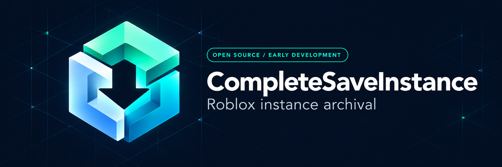

  

# CompleteSaveInstance

La [documentation des presets](https://g0shtj0sh.github.io/CompleteSaveInstance/docs/PRESETS/)
propose un bouton **Copier le script** pour chaque configuration, avec le choix
**Universal / Potassium**. Le [dossier Potassium](Executors/Potassium/README.md)
contient une entrée adaptée et cinq presets : lectures binaires natives,
compression LZ4 contrôlée et rapports détaillés. Les résultats réels restent à
vérifier dans Studio.

**Une base claire pour sauvegarder les instances Roblox accessibles.**

[Site de documentation](https://g0shtj0sh.github.io/CompleteSaveInstance/) · [Script Presets](Script%20Presets/README.md) · [English](README.md) · [Utilisation](docs/USAGE.md) · [Dépannage](docs/TROUBLESHOOTING.md) · [Feuille de route](docs/ROADMAP.md)

CompleteSaveInstance est un projet Luau d’export de places et de modèles Roblox.
Cette première étape apporte son identité visuelle, sa documentation, ses
espaces de noms et les contrôles du dépôt. La fiabilité des exports dans Roblox
et leur ouverture dans Studio restent à valider pour cette distribution.

Le site public comprend maintenant la référence API, un index des options,
la recherche et le guide des presets. **UltraCompleteSveInstance** est notre
configuration expérimentale de travail pour la couverture maximale.

Le preset [UltraNoModuleScripts](docs/PRESETS.md#ultranomodulescripts) conserve les réglages Ultra en excluant les ModuleScript et leurs descendants. Disponible en Universal et Potassium, avec un bouton de copie dans la documentation.

## Ce qui est présent

- Export binaire et XML hérité du moteur existant.
- Sélection des instances et exclusion de propriétés.
- Script principal `saveinstance.luau` et variante Lua plus ancienne.
- Logo, bannière, guides, modèles de tickets et contrôles automatiques.

## Premier essai

Commencer par une petite place possédée ou autorisée. Lire le
[guide d’utilisation](docs/USAGE.md), vérifier les API d’écriture sur un fichier
témoin et utiliser les options explicites du [README principal](README.md#getting-started).

Le dépôt et le site de documentation sont publics. Aucun token GitHub n’est
nécessaire. Les [presets](Script%20Presets/README.md) proposent des liens de
lancement vers une version précise du moteur.

## Script Presets

- **DiagnosticSaveInstance** : premier diagnostic de sérialisation et d’écriture.
- **MapSaveInstance** : export orienté map, sans décompilation ni bytecode.
- **ScriptsSaveInstance** : export des scripts accessibles et autorisés.
- **UltraCompleteSveInstance** : notre preset expérimental en cours de mise au point,
  pour récupérer le plus de contenu accessible possible d’une place.

Tous utilisent le même moteur avec des paramètres différents. Ultra active les
options de couverture étendue, avec des délais par tâche bornés, mais ses
résultats dans Roblox et Studio restent à valider.

La version **0.4.2** corrige le gestionnaire des tâches de scripts et évite les
lectures répétées du bytecode. Les deux profils écrivent un fichier
`<export>.progress.json` pendant l'exécution pour identifier la dernière opération
annoncée en cas de gel. Conserver ce fichier avec les logs ; un délai Lua ne
peut pas interrompre un appel natif qui bloque tout le client.

Une fonction terminée ne garantit pas l’existence du fichier. Vérifier sa
présence, puis son ouverture et son contenu dans Roblox Studio. Les références
d’assets ne constituent pas une copie de leurs fichiers binaires.

Depuis la **0.4.3**, aucun en-tête « Saved by CompleteSaveInstance » ni lien
« Original Source » n'est ajouté aux scripts exportés. Les commentaires du
code récupéré ou du décompilateur sont conservés. Ultra conserve aussi le bloc
de bytecode Base64 lorsque `SaveBytecode` est activé.

La **0.4.4** réduit les attentes d'affichage et d'ordonnancement par script dans
le moteur Luau commun. Les deux Ultra conservent leur couverture, le bytecode
et leurs délais. Le gain sur un export complet dépend des appels natifs et du
nombre de scripts ; un export déjà lancé garde son ancienne version du moteur.

La **0.5.0** ajoute une barre de progression sous l'opération en cours, avec
des compteurs par étape. Le budget de travail Lua passe à **4 ms** par défaut
(`WorkBudgetMs`, réglable de 1 à 16), y compris dans les grandes boucles binaires.
Cela vise à préserver la réactivité du jeu ; les appels natifs longs peuvent
toujours bloquer une image et aucun FPS cible n'est garanti.

## Suite du développement

Les compteurs, checkpoints et rapports sont disponibles. Les prochaines étapes
sont la validation du fichier et la reprise après interruption. Une ouverture
et une inspection dans Studio restent nécessaires pour valider le résultat.

Le client ne dispose pas des scripts serveur non répliqués, des DataStores
privés ou des objets jamais chargés. Pour ses propres projets, examiner
d’abord les exports proposés par Roblox Studio.

## Licence et origine

Licence [AGPL-3.0](LICENSE). Les crédits requis, la provenance du code et les
remerciements sont regroupés dans [NOTICE.md](NOTICE.md).

Projet indépendant, sans affiliation avec Roblox Corporation.
